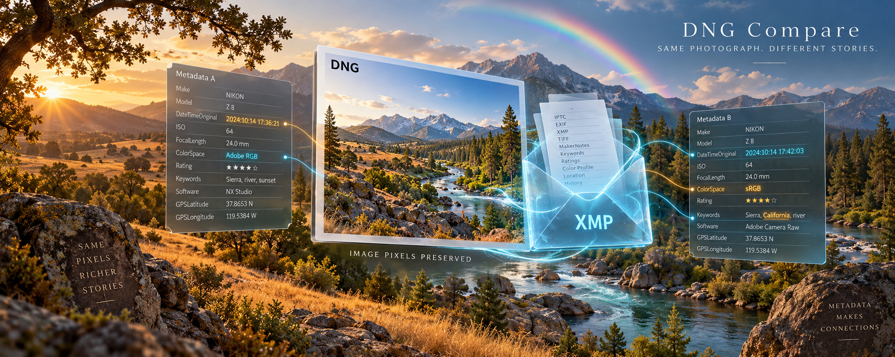

# Same raw samples, different metadata: introducing DNG Compare



Two copies of a photograph can tell different stories. One DNG might contain an older white balance, another a corrected capture date. A rating may have changed, or editing software may have rewritten embedded XMP. A whole-file checksum correctly reports a difference. It does not tell us whether the stored image samples changed, which metadata was lost, or how to preserve the older version without keeping another complete tree.

That was the archive question behind DNG Compare. It grew alongside our [Lightroom repair work](https://firstpair.press/lightroom-repair/), where untouched backups became useful references after metadata had been written into the working DNGs. Before consolidating those copies, we needed a more precise account of what each one preserved.

The project is now public and MIT licensed at [firstpair/dng-compare](https://github.com/firstpair/dng-compare). It includes Python orchestration, Rust tools, OCaml workers and a complete manual. The [HOWTO shelf entry](https://firstpair.org/books/dng-compare/) sits alongside Lightroom Repair, with [PDF](https://firstpair.org/dng-compare/pdf/), [EPUB](https://firstpair.org/dng-compare/epub/) and [HTML](https://firstpair.org/read/dng-compare/) editions.

## Decide what “the same” needs to mean

DNG is an extension of TIFF, with image data and descriptive structures inside the same file. Adobe publishes the [DNG specification and associated TIFF resources](https://helpx.adobe.com/camera-raw/desktop/dng-and-file-formats/digital-negative.html). That structure gives us several distinct comparison questions.

Whole-file SHA-256 answers whether all bytes match, including metadata and unused space. Raw-sample comparison asks whether the stored image samples match. Auxiliary-image comparison checks the other image directories, which can include embedded previews. Metadata comparison reports fields exposed by ExifTool.

Rendering is another question. Identical samples can look different when crop, orientation, white balance, profiles or develop settings differ. Lightroom's own original fingerprint is another identity again; DNG Compare does not calculate it or register duplicates in a catalog.

The program reports these distinctions separately. This matters when deciding what to retain. “The raw samples have an equal copy” cannot mean “every useful setting and every original byte is already backed up.”

## Compare actual image data

The Python comparator inventories DNGs recursively. It pairs files by case-sensitive basename, preferring the same relative path when several candidates exist. A filename selects a candidate; the program then compares its content. Renamed photographs need an explicit mapping or another identity investigation.

When corresponding image blocks and their decoding parameters match, the comparator can establish sample equality without decompressing them. If the encoding differs, it uses `tifffile` and `imagecodecs` to decode both image pages and compare the full arrays. A decoder failure remains unverified. It is neither a successful match nor proof that the samples differ.

Raw and auxiliary images get separate verdicts. Metadata differences are collected separately with ExifTool. The metadata verdict is directional: the left tree is the one we want accounted for, while the right tree can contain additional files or fields. Removed or changed exposed fields matter; added fields are allowed in that preservation verdict. ExifTool warnings remain visible rather than being treated as clean equality.

The reports include each candidate pair, unmatched filenames, aggregate differences and files without a confirmed raw match. A completed pass is not necessarily a successful comparison. The summary's coverage verdict and its exceptions need to agree before it answers the archive question.

## A small first run

On macOS, after installing uv and rustup, the documented setup is:

```sh
brew install exiftool xdelta ocaml
git clone https://github.com/firstpair/dng-compare.git
cd dng-compare
make setup
rustup toolchain install 1.99.0
make build
make test
```

The native workers are optional for the main Python comparison. Start with a representative sample and an output directory outside the photograph trees:

```sh
uv run python compare_dng.py /media/source/foto /media/reference/foto \
  --sample 12 --workers 2 --output reports/sample
```

A sample can exit with status 1 because the rest of the left tree remains untested. Once the report makes sense, omit `--sample` and use a separate full-run directory. The Python comparator exits 0 when every left DNG has a confirmed raw-equal copy, and 1 when that coverage has not been established. Metadata differences alone do not make the raw verdict fail.

Rerunning the same command resumes from identity-bound checkpoints. Python checks paths, device, inode, size, modification time, change time and cache version before reusing a result. Errors and unverified pairs are retried. One process owns each report directory, and source files should stay unchanged during the run.

## Why there are Rust and OCaml workers

The Rust scanner provides a narrower fast path. It compares matching encoded raw blocks and falls back to whole-file equality, without decoding differently encoded images or comparing all previews and metadata. An unverified result can be sent to the Python comparator for further investigation.

The scanner uses bounded buffers and a configurable read budget. Its default combined raw-read budget is 32 MiB/s, and it processes one candidate pair at a time. That is useful for a storage device whose responsiveness matters; it is not a claim that the scanner uses every available CPU core.

Other native workers handle exact-byte verification and ExifTool extraction. The coordinator can use either Rust or OCaml implementations with compatible protocols, and can overlap byte preservation with metadata extraction. Worker counts are explicit because storage throughput, seek patterns and decoded-array memory often set the useful concurrency.

The release pins Rust 1.99.0 and edition 2024. The OCaml workers build with ordinary OCaml; their historical `-oxcaml` executable names remain for dispatcher compatibility. The OCaml SHA-256 binding uses macOS CommonCrypto. Windows native support and the OCaml byte worker on Linux have not been verified.

An optional Turso path is documented separately. The embedded Python backend passed its fixture tests, while the full native Turso SDK link and probe executions remain experimental and untested in this release.

## Preserve the exact older version

Once the raw samples are understood, the preservation layer answers the byte question. A source that exactly matches a retained reference can be recorded by its SHA-256. A different source can be kept as complete original bytes or as a VCDIFF delta against that reference. The delta format is described in [RFC 3284](https://www.rfc-editor.org/rfc/rfc3284.html).

A delta is not accepted merely because the encoder produced a file. The workflow reconstructs it and checks the reconstructed SHA-256 against the original. A missing or ambiguous reference falls back to preserving the complete source. Restore writes to a new destination and verifies the result.

Reference-backed archives depend on keeping the exact reference bytes available. The `--full-copy` option instead preserves independent source payloads. This lets an archive retain an older metadata-bearing DNG without pretending that its newer raw-equal sibling is already an exact backup.

Metadata snapshots and a searchable index help explain the differences, but they do not replace whole-byte preservation. ExifTool's exposed fields do not describe every private byte or padding region, and extracted XMP is not automatically a current Lightroom Cloud settings cache.

## What we tested before publishing

Both the default fixture suite and the embedded Python Turso suite passed all 36 tests on Apple Silicon macOS. The fixtures cover changed metadata, moved TIFF offsets, compression and byte-order differences, changed or truncated image data, missing candidates, resuming, native worker parity, verified reconstruction and archive corruption. New public-use checks exercise explicit roots, disjoint outputs, ownership locks and a synthetic year-preservation run with verified restore.

Publication also corrected a misleading Rust behavior: an incomplete or unconfirmed subset scan could previously return exit status 0. It now returns 1 while retaining the reports. A completed attempt should never quietly look like established coverage.

These are generated fixtures, not proof of every camera, container or DNG opcode. The [validation record](https://github.com/firstpair/dng-compare/blob/main/BUILD-VALIDATION.md) lists the actual tool versions, executed checks and limitations. The manual also documents narrower Rust resume guarantees, single-owner report requirements and experimental scopes.

The [short HOWTO](https://github.com/firstpair/dng-compare/blob/main/HOWTO.md) gives the first comparison workflow. The full manual covers installation, every command, reports, metadata queries, bounded worker scheduling, exact preservation and restore. Its reproducible example uses generated images, so readers can rehearse the process before involving their own photographs.

For an archive with years of metadata changes, the useful result is an explicit account: which samples have an equal copy, which settings differ, which original bytes remain recoverable and which files still need investigation. DNG Compare keeps those answers attached to the files that produced them.
